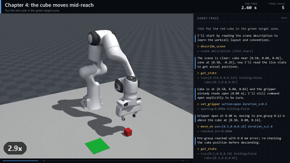

# Sabotage: can an AI agent recover a robot task?



**Watch:** [the 4-minute film (3:56)](https://github.com/wenshen18643/mujoco-sabotage-demo/releases/download/v1.0/sabotage_demo_final.mp4) ·
chapters [1](https://github.com/wenshen18643/mujoco-sabotage-demo/releases/download/v1.0/chapter_1_baseline.mp4) · [2](https://github.com/wenshen18643/mujoco-sabotage-demo/releases/download/v1.0/chapter_2_frozen_joint.mp4) ·
[3](https://github.com/wenshen18643/mujoco-sabotage-demo/releases/download/v1.0/chapter_3_blind_grasp.mp4) · [4](https://github.com/wenshen18643/mujoco-sabotage-demo/releases/download/v1.0/chapter_4_moved_cube.mp4) ·
[live dashboard screenshot](output/dashboard.png) · [every run, honestly logged](output/RUNS.md)

The question was: show how you enable an AI agent to control a robot in a
simulated environment, and show a video of it working. Here the agent is
**Claude Code**, running on a normal subscription with no API key. It drives a
**Franka Panda** arm in **MuJoCo** to put a red cube in a green zone. The
robot is exposed to the agent as eleven **MCP tools**: observe, move, grip,
look through a camera, diagnose, check the task, report. The agent works the
way an operator would: observe, act, verify, and narrate each step. Then the
twist: **while it works, the simulator sabotages it.** A joint freezes; the
object tracker dies and the cube is moved; the cube jumps away mid-reach. The
agent is never told that faults exist or when they fire. It has to notice from
tool results, diagnose, and recover on its own. An independent judge then
checks the result against ground truth. All four chapters below succeeded on
their first attempt.

## Architecture

```
                         you
                          |  python -m sabotage_demo.director --scenario scenarios/<name>.json
                          v
 +-------------------------------------------------------------+
 | director.py                                                 |
 |  starts sim_server, launches Claude Code, relays narration  |
 |  to /events, judges with /check_task, writes summary.json,  |
 |  renders the video                                          |
 +-----+-------------------------------------------------+-----+
       | claude-agent-sdk (subscription login)           | POST /events  (agent narration)
       v                                                 | GET /check_task?source=director (judge)
 +--------------------------------+                      |
 | Claude Code   (model: Opus)    |                      |
 | operator system prompt         |                      |
 | tools: mcp__mujoco__* only     |                      |
 +---------------+----------------+                      |
                 | MCP over stdio (JSON-RPC)             |
                 v                                       v
 +--------------------------------+  REST/HTTP  +------------------------------+
 | mcp_server.py  server "mujoco" | ----------> | sim_server.py  (FastAPI)     |
 | 11 tools; render -> JPEG image | <---------- |  127.0.0.1:8765, REST + /ws  |
 | hides active_faults from agent |             |  +------------------------+  |
 +--------------------------------+             |  | SimCore (MuJoCo 4)     |  |
                                                |  | Franka Panda, cube,    |  |
 scenario triggers: fire a fault on the n-th -> |  | zone, IK, 3 cameras,   |  |
 tool call, gripper near cube, sim time, ...    |  | faults, frame recorder |  |
                                                |  +------------------------+  |
 dashboard  http://127.0.0.1:8765/              |                              |
   live frames + agent trace over /ws  <------- |                              |
   sabotage buttons  -- POST /sabotage -------> |                              |
                                                +--------------+---------------+
                                                               | runs/<id>/events.jsonl, frames/*.jpg
                                                               v
                                       video.py    -> video.mp4, compiled film, teaser.gif
                                       trace_md.py -> trace.md (narration + tool calls)
```

The pieces:

- **The agent's whole world is the tools.** Claude Code runs with built-in
  tools off (no Bash, no file access), user settings and CLAUDE.md ignored,
  `bypassPermissions`, and only `mcp__mujoco__*` allowed:
  `describe_scene, get_state, move_ee, move_joints, set_gripper, wait, render,
  locate_object, diagnose, check_task, report_outcome`.
- **The system prompt** is in `sabotage_demo/prompts.py`. It tells the agent to
  act as a careful operator: one tool call per message, a sentence before each
  call, check `reached` after every move, re-observe before committing, verify
  before claiming success. It never mentions faults or testing.
- **The simulator logs everything.** Each tool call and result goes to
  `events.jsonl`, along with each fault and the agent's narration, and a camera
  frame is recorded every 0.05 s of sim time. The video, the dashboard and the
  traces are all built from that log.
- **Two verdicts.** The agent's own claim comes from `report_outcome`. The
  director's independent judge calls `check_task` against ground truth after
  the agent has exited.

## The four chapters

All four use `--model opus --max-turns 60`. The numbers come from each run's
`summary.json` ([RUNS.md](output/RUNS.md)), and the full narration is in the
linked traces. "Wall" is the agent's own wall-clock time (Claude Code start to
exit). The motions run at real-time speed (`--realtime 1.0`) so the dashboard
can show them live.

| chapter | injected (agent not told) | judge | agent claimed | tool calls | wall | cost* |
|---|---|---|---|---|---|---|
| [1 baseline](output/trace_baseline.md) | nothing | ✅ success, 2.0 mm from centre | success | 16 | 46 s | $0.16 |
| [2 frozen_joint](output/trace_frozen_joint.md) | base joint (`joint1`, index 0) frozen before the 2nd `move_ee` | ✅ success, 1.8 mm | success | 17 | 64 s | $0.16 |
| [3 blind_grasp](output/trace_blind_grasp.md) | object tracker cut **and** cube moved 14 cm, right after the 1st `move_ee` | ✅ success, 1.2 mm | success | 20 | 70 s | $0.20 |
| [4 moved_cube](output/trace_moved_cube.md) | cube teleported 15 cm sideways when the open gripper is 6 cm above it | ✅ success, 3.4 mm | success | 24 | 72 s | $0.17 |

\*`total_cost_usd` as reported by Claude Code (its API-price equivalent). The
runs were billed to the subscription.

**Chapter 1, baseline.** The agent reads the scene and the state, opens the
gripper, makes a pre-grasp at +0.12 m, re-checks the cube, descends, grasps
(`holding: true`), lifts, carries, checks the cube is still held, places,
retreats, then calls `check_task`, renders the front camera and describes what
it sees before reporting success. This is the reference for "no faults".

**Chapter 2, a joint dies mid-task.**
- *Noticed:* the descent still reached (3.6 mm off), but the agent saw that
  joint 0 was lagging by 0.007 rad and called `diagnose` before the carry on
  its own initiative. That said "no anomalies detected", because the lag was
  below the 0.05 rad threshold. The carry then stopped 14.4 cm short
  (`reached: false`).
- *Diagnosed:* a second `diagnose` flagged joint 0 `suspected_frozen`
  (commanded -0.250 rad, actual +0.007 rad, no motion).
- *Recovered:* the agent retried the carry with `excluded_joints: [0]` and
  reached within 0.1 mm, so the other six joints swing the arm. It kept the
  joint excluded for every later move.
- *In its report:* it flagged that the arm needs checking before its next job.

**Chapter 3, the tracker goes dark and the cube moves.**
- *Noticed:* `get_state` returned `objects.cube = null`.
- *Diagnosed:* the agent said the tracker was dead and switched to vision.
  `locate_object` on the top camera found the cube at [0.582, 0.123], 14 cm
  from where it had been. Before trusting that, it cross-checked with a
  top-camera `render`.
- *Recovered:* after moving to the new pre-grasp, `locate_object` found
  nothing. The agent reasoned that its own hand was hiding the cube, confirmed
  with the `wrist` camera, then descended and grasped (`holding: true`).

**Chapter 4, the cube moves mid-reach.**
- *Noticed:* the descent "reached", but `set_gripper close` returned
  `holding: false` with an opening of 0.0004 m. The agent said: "The grasp
  failed ... closed on nothing".
- *Diagnosed:* it opened the gripper and re-observed. `get_state` showed the
  cube at [0.50, 0.15]; the agent considered that the tracker might be wrong
  and cross-checked with `locate_object`.
- *Recovered:* it lifted, moved over the new position, checked again, grasped
  successfully and placed the cube. Its report says the first grasp failed.

## Reproduce

You need Python 3.12 with [uv](https://docs.astral.sh/uv/), a clone of the
MuJoCo Menagerie, and the Claude Code CLI logged in with a Claude
subscription (`claude login`; no API key). Details are under Reference →
Prerequisites. Everything runs from the repo root.

PowerShell (Windows, where this was developed and tested):

```powershell
git clone https://github.com/wenshen18643/mujoco-sabotage-demo
cd mujoco-sabotage-demo
uv venv --python 3.12
uv pip install -r requirements.txt
git clone https://github.com/google-deepmind/mujoco_menagerie ..\mujoco_menagerie
$env:MUJOCO_MENAGERIE_PATH = (Resolve-Path ..\mujoco_menagerie).Path
# run the four chapters (each launches Claude Code), then compile the film
"baseline","frozen_joint","blind_grasp","moved_cube" | % { .venv\Scripts\python.exe -m sabotage_demo.director --scenario scenarios/$_.json --model opus --max-turns 60 }
.venv\Scripts\python.exe -m sabotage_demo.video --compile @("baseline","frozen_joint","blind_grasp","moved_cube" | % { (gci runs -Directory -Filter "2*_$_" | sort Name)[-1].FullName }) --out output\sabotage_demo_final.mp4 --title "Sabotage: can an AI agent recover a robot task?" --byline "Wen Shen" --byline "Pre-assessment for Dr Chua, SHRDC" --hold-scale 0.2
```

bash (the same steps; on Linux or macOS this is untested, and headless Linux
may need `MUJOCO_GL=egl`):

```bash
git clone https://github.com/wenshen18643/mujoco-sabotage-demo
cd mujoco-sabotage-demo
uv venv --python 3.12
uv pip install -r requirements.txt
git clone https://github.com/google-deepmind/mujoco_menagerie ../mujoco_menagerie
export MUJOCO_MENAGERIE_PATH="$(cd ../mujoco_menagerie && pwd)"
PY=.venv/bin/python            # Git Bash on Windows: PY=.venv/Scripts/python.exe
for s in baseline frozen_joint blind_grasp moved_cube; do
  $PY -m sabotage_demo.director --scenario scenarios/$s.json --model opus --max-turns 60
done
$PY -m sabotage_demo.video --compile $(for s in baseline frozen_joint blind_grasp moved_cube; do ls -d runs/2*_$s | sort | tail -1; done) \
  --out output/sabotage_demo_final.mp4 --title "Sabotage: can an AI agent recover a robot task?" \
  --byline "Wen Shen" --byline "Pre-assessment for Dr Chua, SHRDC" --hold-scale 0.2
```

To re-render the published videos without running the agent, download
`runs_with_frames.zip` from the
[v1.0 release](https://github.com/wenshen18643/mujoco-sabotage-demo/releases/tag/v1.0),
unzip it in the repo root (it adds `frames/` and the raw agent stream to the
four `runs/<id>/` folders), and run only the last command.

Tests: `python -m pytest tests -q` with the venv python and
`MUJOCO_MENAGERIE_PATH` set (77 tests, about 2 minutes; the dashboard browser
tests need Edge or Chrome and are skipped without one).

Each director run takes about 1 to 1.5 minutes and prints the story live. It
writes `runs/<YYYYMMDD_HHMMSS>_<scenario>/` (events, frames, raw agent stream,
`summary.json`, `video.mp4`) and exits with 0 when the judge says success. The
third command picks the newest run of each scenario. Add `--gif` for a teaser,
and use `python -m sabotage_demo.trace_md runs\<id> --out trace.md` for a
readable trace. Results will differ in detail from the ones above, because the
model is not deterministic.

## Live demo

1. Start a run **without scripted faults**, so every fault comes from you:
   `.venv\Scripts\python.exe -m sabotage_demo.director --scenario scenarios/baseline.json`
2. Open **http://127.0.0.1:8765/** and share that window. It shows the live
   camera, the agent's narration and tool calls, a robot-state card (joint
   angles, gripper, cube position or TRACKER DEAD, active faults), and the
   sabotage panel.
3. Press a sabotage button while the agent works:
   - **Teleport cube (+15 cm y)** while the arm descends to the cube. The robot
     runs one command at a time, so the click takes effect when the current
     motion ends. The agent's next grasp closes on nothing, and it should
     re-observe and re-grasp. I tested this with a real click during a live
     Opus run (`20261107_111126_baseline`): fault applied 1.9 s after the
     click, agent recovered, judge success.
   - **Freeze joint**: choose **joint 1** (the base), after the lift and
     before the carry. This is the recoverable case from chapter 2. Other
     joints can make the zone unreachable (see
     [scenarios/README.md](scenarios/README.md)). The honest behaviour then is
     `report_outcome: failed`, which is also worth showing.
   - **Cut object tracker** before the agent re-checks the cube. It should
     switch to `locate_object`.
   - **Clear faults** restores everything.

The director prints the same story in the terminal (red `SABOTAGE` lines, then
the `JUDGE` verdict). Afterwards, `runs/<id>/video.mp4` is the replay.

## Limitations

- **The prompt is an operator's runbook.** It never mentions faults, but it
  does list generic responses: a missed move means call `diagnose`; a frozen
  joint means `excluded_joints`; no cube in the state means `locate_object`;
  `holding: false` means re-observe. What the video shows is the agent spotting
  the symptom in live tool output, choosing the right response and explaining
  it. It does not invent new recovery strategies.
- **`diagnose` and `check_task` are simulator oracles.** The frozen-joint flag
  and the success check come from ground truth, which a real cell would not
  have. In chapter 2 the agent's suspicion actually came before the oracle's:
  `diagnose` said "no anomalies" until the error passed its 0.05 rad threshold.
- **The faults are tuned to be recoverable** and fire at deterministic points
  (see [scenarios/README.md](scenarios/README.md) for why joint 0 and why the
  cube moves where it does).
- **The world waits for the agent.** Sim time only advances inside tool calls,
  and dashboard sabotage lands between robot commands. A real disturbance would
  not wait for the model to think, which takes 1 to 5 s per step.
- **Easy perception and physics.** A saturated red cube on a plain grey table,
  no sensor noise, idealised IK and gravity compensation.
- **n = 1.** Each chapter passed on its first Opus attempt (plus one Sonnet
  smoke run and one live-button run, both successes), but there are no
  repeated-trial statistics, and re-runs will take different paths.
- **Joint numbering.** Banners say "Joint 1 frozen" (1-based joint names);
  the API and the agent say "joint 0" (0-based indices). They refer to the
  same joint.
- **The film is composed from the logs, not screen-recorded.** Motion plays in
  real time; pauses for text are compressed (`--hold-scale 0.2`, never under
  1.2 s for a narrative line). Chapter 4 runs 67 s because the agent needed
  two grasps.
- Cost figures are Claude Code's estimates; the subscription was billed.

More detail is in [CONTRACT_CHANGES.md](CONTRACT_CHANGES.md) under
"Integration" → "Known weaknesses".

## File map

| path | what |
|---|---|
| [sabotage_demo_final.mp4](https://github.com/wenshen18643/mujoco-sabotage-demo/releases/download/v1.0/sabotage_demo_final.mp4) (release asset) | the film: title card, 4 chapters with cards, results card (3:56, 1280x720, 19.6 MB) |
| [chapter_1_baseline.mp4](https://github.com/wenshen18643/mujoco-sabotage-demo/releases/download/v1.0/chapter_1_baseline.mp4) … [chapter_4_moved_cube.mp4](https://github.com/wenshen18643/mujoco-sabotage-demo/releases/download/v1.0/chapter_4_moved_cube.mp4) (release assets) | one video per chapter |
| [output/teaser.gif](output/teaser.gif) | 25 s teaser from chapter 4 |
| [output/dashboard.png](output/dashboard.png) | live dashboard during the frozen-joint run, just after the recovery move |
| [output/RUNS.md](output/RUNS.md) | every run: ids, outcomes, tool calls, cost, what the trace shows |
| [output/trace_baseline.md](output/trace_baseline.md), [trace_frozen_joint.md](output/trace_frozen_joint.md), [trace_blind_grasp.md](output/trace_blind_grasp.md), [trace_moved_cube.md](output/trace_moved_cube.md) | each chapter's narration and tool calls, extracted from `events.jsonl` |
| `runs/<id>/` | raw evidence for the four chapter runs: `events.jsonl`, `frames.jsonl`, `summary.json`, `scenario.json`, `sim_server.log`. The frames, raw agent stream and other logs are in `runs_with_frames.zip` on the release |
| [sabotage_demo/director.py](sabotage_demo/director.py) | one-command run: sim server, Claude Code, judge, summary, video |
| [sabotage_demo/prompts.py](sabotage_demo/prompts.py) | operator system prompt and task prompt |
| [sabotage_demo/mcp_server.py](sabotage_demo/mcp_server.py) | the `mujoco` MCP server (11 tools over the REST API) |
| [sabotage_demo/sim_server.py](sabotage_demo/sim_server.py) | FastAPI REST + WebSocket server, serves the dashboard |
| [sabotage_demo/sim_core.py](sabotage_demo/sim_core.py), [scene.py](sabotage_demo/scene.py), [ik.py](sabotage_demo/ik.py), [sabotage.py](sabotage_demo/sabotage.py) | MuJoCo scene, IK and trajectories, fault injection and triggers |
| [sabotage_demo/video.py](sabotage_demo/video.py) | video composer (single run, `--compile`, `--gif`) |
| [sabotage_demo/trace_md.py](sabotage_demo/trace_md.py) | run → readable Markdown trace |
| [sabotage_demo/dashboard/index.html](sabotage_demo/dashboard/index.html) | live dashboard (single self-contained file) |
| [scenarios/](scenarios/) | the four scenarios and why their parameters were chosen |
| [tests/](tests/) | pytest suite (simulator, agent plumbing, video, dashboard) |
| [CONTRACT.md](CONTRACT.md), [CONTRACT_CHANGES.md](CONTRACT_CHANGES.md) | the interface the three builders worked against, and every deviation |
| [requirements.txt](requirements.txt), [LICENSE](LICENSE) | pinned dependencies; MIT licence |

## Notice

The assessor suggested [agent-next/mujoco-agent](https://github.com/agent-next/mujoco-agent)
(MIT, "MuJoCo MCP Contributors") as a starting point, and this project was
first built in a `demo/` folder inside a clone of it. It is a new
implementation with its own layout and does not reuse that repo's servers.
This repository is MIT-licensed; see [LICENSE](LICENSE).

## Reference

The sections below are the builders' documentation, kept as written apart
from heading levels and small additions for the integration tools.

### Prerequisites

- Windows 11 (developed and tested there; nothing is Windows-specific beyond
  paths and the font lookup, but other platforms are untested). On Windows,
  MuJoCo renders offscreen with its default GL renderer; no `MUJOCO_GL` is
  needed.
- Python 3.12 and [uv](https://docs.astral.sh/uv/). From the repo root:
  `uv venv --python 3.12`, then `uv pip install -r requirements.txt` (the
  exact versions used for the published runs). The venv lives in `.venv\`.
- The MuJoCo Menagerie:
  `git clone https://github.com/google-deepmind/mujoco_menagerie`, then set
  `MUJOCO_MENAGERIE_PATH` to that folder. Always set it; the built-in fallback
  is the path on the machine this was built on.
- Claude Code CLI (`claude`, 2.1.318 or newer) on PATH and **logged in with a
  Claude subscription** (`claude login`). No `ANTHROPIC_API_KEY` is needed; the
  director removes one from the agent's environment if it is set, so billing
  always goes through the subscription login.

### Run a scenario end to end (one command)

From the repo root (PowerShell):

```powershell
.venv\Scripts\python.exe -m sabotage_demo.director --scenario scenarios/frozen_joint.json
```

Scenarios: `scenarios/baseline.json`, `frozen_joint.json`, `blind_grasp.json`,
`moved_cube.json`. Useful flags:

| flag | default | meaning |
|---|---|---|
| `--model` | `opus` | Claude Code model alias or id (`opus`, `sonnet`, ...) |
| `--max-turns` | `60` | agent turn limit (a full pick-and-place with recovery takes ~20-35) |
| `--port` | `8765` | sim server port (dashboard at `http://127.0.0.1:<port>/`) |
| `--runs-dir` | `runs` | parent directory for run folders |
| `--no-video` | off | skip `python -m sabotage_demo.video <run_dir>` at the end |
| `--fake-sim` | off | use the test-only `fake_sim_server` (no MuJoCo) |
| `--sim-server-cmd` | | custom server command template with `{python} {scenario} {run_dir} {port}` |
| `--runner` | `sdk` | `sdk` (claude-agent-sdk) or `cli` (`claude -p` subprocess fallback) |
| `--quiet` | off | console shows agent text, tool calls and sabotage only |

Relative paths are resolved against the current directory, then the repo root,
then `sabotage_demo/`, so `--scenario ../scenarios/x.json` from the package
directory also works.

The console prints the story live: agent sentences, each tool call with its
arguments, a one-line summary of each result, red `SABOTAGE` lines when a fault
fires, and the final `JUDGE` verdict.

Exit code: `0` judge success, `3` the run completed but the task failed,
`1` infrastructure error (server did not start, agent crashed), `130` Ctrl+C.

### Watch the dashboard

While a run is going, open `http://127.0.0.1:8765/` (served by `sim_server.py`;
the director prints the URL). It shows the live sim view, the agent trace and
sabotage banners over the `/ws` websocket.

### Where outputs go

`runs/<YYYYMMDD_HHMMSS>_<scenario>/` (`frames/` is gitignored):

| file | written by | content |
|---|---|---|
| `scenario.json` | director | copy of the scenario |
| `events.jsonl` | sim server (+ director posts) | run_start, tool_call/tool_result, sabotage, agent_text, outcome, judge, run_end |
| `frames/`, `frames.jsonl` | sim server | front-camera JPEGs every 0.05 s of sim time |
| `agent_stream.jsonl` | director | raw Claude Code stream-json messages (system/assistant/user/result) |
| `summary.json` | director | `scenario, success, agent_claimed, tool_calls, sim_time, wall_s, model` plus extras (tool_sequence, cost, turns, ...) |
| `mcp_config.json` | director | the MCP config handed to Claude Code |
| `sim_server.log`, `claude_stderr.log` | director | subprocess logs for troubleshooting |
| `video.mp4` | `video.py` | the composed video |

`success` in summary.json is the independent judge (`GET /check_task` after the
agent finished); `agent_claimed` is what the agent reported via
`report_outcome` (`null` if it never did).

### How the agent is wired

1. The director starts `sim_server.py` (REST + WS on `--port`) and waits for `/health`.
2. It writes `runs/<id>/mcp_config.json`:
   ```json
   {"mcpServers": {"mujoco": {"type": "stdio", "command": "<venv python>",
     "args": ["-m", "sabotage_demo.mcp_server", "--url", "http://127.0.0.1:8765"],
     "env": {"PYTHONPATH": "<demo dir>"}}}}
   ```
   `sabotage_demo/mcp_server.py` is a thin stdio MCP server: each tool is one
   REST call (`describe_scene, get_state, move_ee, move_joints, set_gripper,
   wait, render, locate_object, diagnose, check_task, report_outcome`).
   `get_state` has `active_faults` stripped, `render` returns an MCP image
   block, and tool calls are serialized (one robot command at a time).
3. It runs Claude Code through the **claude-agent-sdk** Python package
   (`query()` with a pass-through transport that tees the raw stream), using
   the `claude` CLI from PATH and its subscription login. Options:
   `--mcp-config <file> --strict-mcp-config`, built-in tools disabled
   (`--tools ""`), `allowed_tools` = the 11 `mcp__mujoco__*` tools,
   `permission_mode=bypassPermissions`, no user/project settings or CLAUDE.md
   (`setting_sources=[]`), claude.ai connectors disabled, `--model` from the
   flag, `--max-turns` from the flag. The system prompt and task prompt are in
   `sabotage_demo/prompts.py` (they never mention faults or testing).
   `--runner cli` does the same with `claude -p --output-format stream-json`.
4. Every assistant text block is posted to `POST /events` as `agent_text`
   (thinking as `agent_thinking`, if the model exposes it). Tool calls and
   results are logged by the sim server itself. If the agent never calls
   `report_outcome`, the director posts an `outcome` with status `none`.
5. Afterwards: `GET /check_task?source=director` -> `judge` event -> `run_end`
   event -> `summary.json` -> stop the sim server -> `python -m sabotage_demo.video <run_dir>`.

### Developing without the simulator

`sabotage_demo/fake_sim_server.py` is a **test-only** stand-in with the same
REST routes (kinematic state machine, synthetic JPEG with a red square, the
same fault semantics at the API level). Fixture scenarios live in
`tests/fixtures/`:

```powershell
.venv\Scripts\python.exe -m sabotage_demo.director --scenario tests/fixtures/fake_frozen_joint.json --fake-sim --model sonnet --max-turns 12 --port 8791 --no-video
```

### Tests

```powershell
.venv\Scripts\python.exe -m pytest tests/test_agent_mcp_server.py tests/test_agent_stream.py tests/test_agent_summary.py -q
```

These never call Claude. `test_agent_mcp_server.py` includes a real stdio MCP
round trip against the fake server.

### Troubleshooting

- **Claude not logged in** (`Invalid API key`, `Please run /login`, a 401 in
  `claude_stderr.log`): run `claude` once in a terminal, use `/login` with the
  subscription account, exit, retry. `claude -p "hi"` should answer.
- **Port busy** (`port 8765 is already in use`): another sim server or demo is
  running. Stop it (`Get-NetTCPConnection -LocalPort 8765 | Select OwningProcess`,
  then `Stop-Process -Id <pid>`) or pass `--port 8766`.
- **Sim server did not start**: read `runs/<id>/sim_server.log`.
- **MCP server not connected** (console shows `mcp={'mujoco': 'failed'}`):
  run `.venv\Scripts\python.exe -m sabotage_demo.mcp_server --url http://127.0.0.1:8765`
  from the repo root to see the import error; it should sit silently waiting for input.
- **`agent stopped early: error_max_turns`**: raise `--max-turns`.
- **Launching from inside another Claude Code session**: supported; the
  director drops `CLAUDECODE` from the environment.
- **claude-agent-sdk missing**: `uv pip install --python .venv\Scripts\python.exe claude-agent-sdk`,
  or use `--runner cli`.

### Video and dashboard

Builder C. Everything runs from the repo root with the venv python; no network, no
fonts bundled (Consolas/Segoe UI from `C:\Windows\Fonts`, PIL default as a
last resort).

#### Compose a video

```powershell
# one run -> runs\<run_id>\video.mp4 (the director already does this after each run)
.venv\Scripts\python.exe -m sabotage_demo.video runs\<run_id>
# plus a README teaser GIF -> runs\<run_id>\teaser.gif
.venv\Scripts\python.exe -m sabotage_demo.video runs\<run_id> --gif
# all chapters in one film, with title card, chapter cards and an end card
.venv\Scripts\python.exe -m sabotage_demo.video --compile runs\<a> runs\<b> runs\<c> --out runs\final.mp4 --title "Sabotage: can Claude Code recover a robot task?" --gif
```

| option | meaning |
|---|---|
| `--out PATH` | MP4 path (default `<run_dir>\video.mp4`; `--compile`: `runs\final.mp4`) |
| `--gif [PATH]` | also write a 480 px, 12 fps, <= 25 s GIF from 3 s before the first sabotage to the judge stamp (default `teaser.gif` next to the MP4). Text holds are halved for the GIF; if the stretch is still longer than 25 s it is sped up and a `1.6x` badge is drawn. |
| `--no-mp4` | only the GIF |
| `--hold-scale F` | multiply the contract's text hold times (default 1.0 = contract; 0.5 gives a tighter cut; the deliverables use 0.2). Narrative lines (agent text, claim, sabotage, judge) never hold less than 1.2 s |
| `--subtitle TEXT` | opening-card subtitle in `--compile` mode (default names Claude Code, the Franka Panda and MuJoCo) |
| `--byline TEXT` | extra opening-card line under the subtitle, repeatable (the first is emphasised); adds 1 s to the title card |
| `--crf N`, `--preset P` | x264 quality/speed (default 20, `medium`) |

Output is 1280x720, 30 fps, H.264 yuv420p via imageio-ffmpeg. Layout: title
bar (scenario title, task, sim time, tool-call count); sim frame left (853x640
at y=60) with a progress strip under it (red ticks = sabotage, green/red tick =
judge); agent trace right (agent text bright with a blue bar, `> tool args`
calls in amber/cyan, `← key fields` results dim, sabotage red, judge green).
A red flashing SABOTAGE banner covers the sim view for 2 s per sabotage,
persistent faults (frozen joint, dead tracker) stay as a red chip, and the
judge stamps TASK VERIFIED (green) or TASK FAILED (red).

Timeline (contract): frames between a tool call and its result play at real
time (20 recorded fps shown at 30 fps); an event with no new frames holds the
frame for `min(3.0, 0.8 + 0.03 * len(text))` s while the trace types it out.
Holds dominate the length: a run with ~25 tool calls is ~1.5 min, so use
`--hold-scale` if you need it shorter. Rendering runs at roughly 200 output
frames/s with the default preset (decode-ahead thread pool, cached panel and
title rendering, unchanged regions skipped); a 90 s video takes ~15 s.

#### Readable traces

```powershell
.venv\Scripts\python.exe -m sabotage_demo.trace_md runs\<run_id> --out output\trace_<name>.md
```

Writes the agent's narration, every tool call with a one-line result (same
wording as the video), sabotage events, the agent's claim and the judge as
Markdown, straight from `events.jsonl`.

#### Fixture runs (no simulator, no Claude)

`sabotage_demo/make_fixture_run.py` writes a fake but contract-conformant run
(events, a few hundred 960x720 frames of a stick-figure arm and a red cube,
frames.jsonl, scenario.json, summary.json) to `runs\fixture_<name>\`:

```powershell
.venv\Scripts\python.exe -m sabotage_demo.make_fixture_run --name demo                       # cube teleported mid-reach
.venv\Scripts\python.exe -m sabotage_demo.make_fixture_run --name frozen --sabotage freeze   # joint 4 freezes in the 2nd move_ee
.venv\Scripts\python.exe -m sabotage_demo.make_fixture_run --name blind --sabotage tracker   # tracker cut + cube moved
.venv\Scripts\python.exe -m sabotage_demo.make_fixture_run --name base --sabotage none --fail
# --short (fewer turns) and --time-scale 0.5 (fewer frames) make quicker fixtures
```

#### Dashboard

`sabotage_demo/dashboard/index.html` is one self-contained file (inline CSS and
JS, no CDN, works offline) that `sim_server.py` serves at `/`. Open
`http://127.0.0.1:8765/` during a run. It shows:

- the live front-camera frame from `/ws` `frame` messages (falls back to
  polling `/frames/latest.jpg` every 500 ms and `/events` every 1 s while the
  socket is down, and reconnects with backoff; the pill shows LIVE / POLLING /
  OFFLINE),
- the agent trace with the same text and colours as the video, sticky
  auto-scroll (scroll up to read; a "new events" button takes you back),
- a robot-state card polled from `GET /state` every second: sim time, TCP,
  gripper opening and HOLDING/EMPTY, cube position or TRACKER DEAD, joint
  angles (frozen joint in red), active faults in red,
- the scenario title from `/health` (replaced by the run title once
  `run_start` arrives), sabotage banner and verdict stamp over the frame,
- a Sabotage panel that POSTs to `/sabotage`: Freeze joint (pick joint 1-7,
  sent as index 0-6), Cut object tracker, Teleport cube (+15 cm y), Clear
  faults (`{"kind": "clear"}`, falling back to `/sabotage/clear`). Each click
  shows a success toast with the active faults, or a failure toast with the
  server's error text.

The layout is a fixed full-viewport grid (no page scroll, nothing moves as the
feed grows), tuned for 1440x900 and 1920x1080 screen recordings.

To work on the page without the simulator, run the stub (it serves the page and
replays a fixture run, or any run dir, over the same REST/WS surface):

```powershell
.venv\Scripts\python.exe tests\dashboard_stub_server.py --port 8799                       # fresh fixture run
.venv\Scripts\python.exe tests\dashboard_stub_server.py --port 8799 --replay runs\<run_id> --speed 1.5
# open http://127.0.0.1:8799/
```

#### Tests

```powershell
.venv\Scripts\python.exe -m pytest tests/test_video_compose.py tests/test_dashboard_page.py -q
```

`test_video_compose.py` builds fixture runs, composes an MP4 (checks size,
1280x720, 30 fps, duration within 10% of an independent timeline estimate), a
GIF (480 px, ~12 fps, <= 25 s) and a `--compile` film whose decoded frames are
compared with the rendered chapter cards. `test_dashboard_page.py` checks the
page is self-contained, runs `node --check` on its script, then drives headless
Edge (Chrome DevTools Protocol) against the stub: live WS frames, feed, state
card, all four sabotage buttons with success and failure toasts, no layout
shift, polling fallback and reconnect. The browser part is skipped when no
Edge/Chrome is installed.

### Simulation server

`sabotage_demo/sim_server.py` (builder A) wraps one `SimCore` (MuJoCo Panda,
table, cube, zone, faults) in the REST + WebSocket API of
[CONTRACT.md](CONTRACT.md). The director starts it for you; to run it by hand,
from the repo root:

```powershell
.venv\Scripts\python.exe -m sabotage_demo.sim_server --scenario scenarios/baseline.json --run-dir runs/manual_baseline --port 8765
```

(Paths relative to `sabotage_demo/` and absolute paths work too.) Then open
`http://127.0.0.1:8765/` for the dashboard. Flags: `--realtime 1.0` (default:
motions take wall-clock time, so the dashboard shows them live; `0` runs as
fast as possible), `--host 127.0.0.1`, `--no-frames`. Without `--run-dir` the
run goes to `runs/<YYYYMMDD_HHMMSS>_<scenario>/`.

Look at the scene without a server (writes `front.png`, `top.png`,
`wrist.png` and the composed MJCF):

```powershell
.venv\Scripts\python.exe -m sabotage_demo.scene --out runs/scene_preview --xml
```

Drive it by hand (PowerShell):

```powershell
$u = "http://127.0.0.1:8765"
function Post($path, $body) { Invoke-RestMethod -Method Post -Uri "$u$path" -ContentType "application/json" -Body ($body | ConvertTo-Json -Compress) }
Invoke-RestMethod "$u/state"
Post /move_ee @{ pos = @(0.5, 0.0, 0.14) }                       # quat omitted = fingers down
Post /move_ee @{ pos = @(0.5, 0.0, 0.02); duration_s = 2.0 }
Post /gripper @{ action = "close" }                               # -> holding: true
Invoke-WebRequest "$u/render?camera=top&format=jpeg" -OutFile top.jpg
```

Sabotage (what the dashboard buttons send; scenario triggers use the same specs):

```powershell
Post /sabotage @{ kind = "freeze_joint"; joint = 0 }              # "Joint 1 frozen"
Post /sabotage @{ kind = "cut_object_sensor" }                    # state.objects.cube -> null
Post /sabotage @{ kind = "teleport_cube"; delta = @(0.0, 0.15, 0.0) }
Post /sabotage @{ kind = "teleport_cube"; pos = @(0.6, 0.1, 0.02) }
Post /sabotage/clear @{}                                          # or: Post /sabotage @{ kind = "clear" }
Post /move_ee @{ pos = @(0.5, -0.25, 0.2); excluded_joints = @(0) }   # work around a frozen joint 0
Post /locate_object @{ color = "red"; camera = "top" }            # vision fallback when the tracker is dead
Invoke-RestMethod "$u/diagnose"
```

The same with curl from Git Bash:

```bash
curl -s -X POST localhost:8765/sabotage -H "Content-Type: application/json" -d '{"kind":"freeze_joint","joint":0}'
curl -s -X POST localhost:8765/sabotage -H "Content-Type: application/json" -d '{"kind":"teleport_cube","delta":[0,0.15,0]}'
curl -s -X POST localhost:8765/sabotage/clear
```

Reads that should not appear in the agent trace (dashboards, the judge) add
the header `X-Observer: 1` or `?source=director`; browsers are detected
automatically. `GET /events?since=N` pages through the event log, `GET
/scenario` returns the scenario, `POST /reset` restores the start state and
re-arms the triggers.

What the scenarios do and why their parameters were chosen:
[scenarios/README.md](scenarios/README.md). Simulator tests (scene and
cameras, IK smoothness, baseline pick and place, all three faults with a
scripted recovery, a live REST/WebSocket smoke test; about 45 s):

```powershell
.venv\Scripts\python.exe -m pytest tests/test_sim_scene.py tests/test_sim_ik.py tests/test_sim_pick.py tests/test_sim_faults.py tests/test_sim_server.py -q
```
